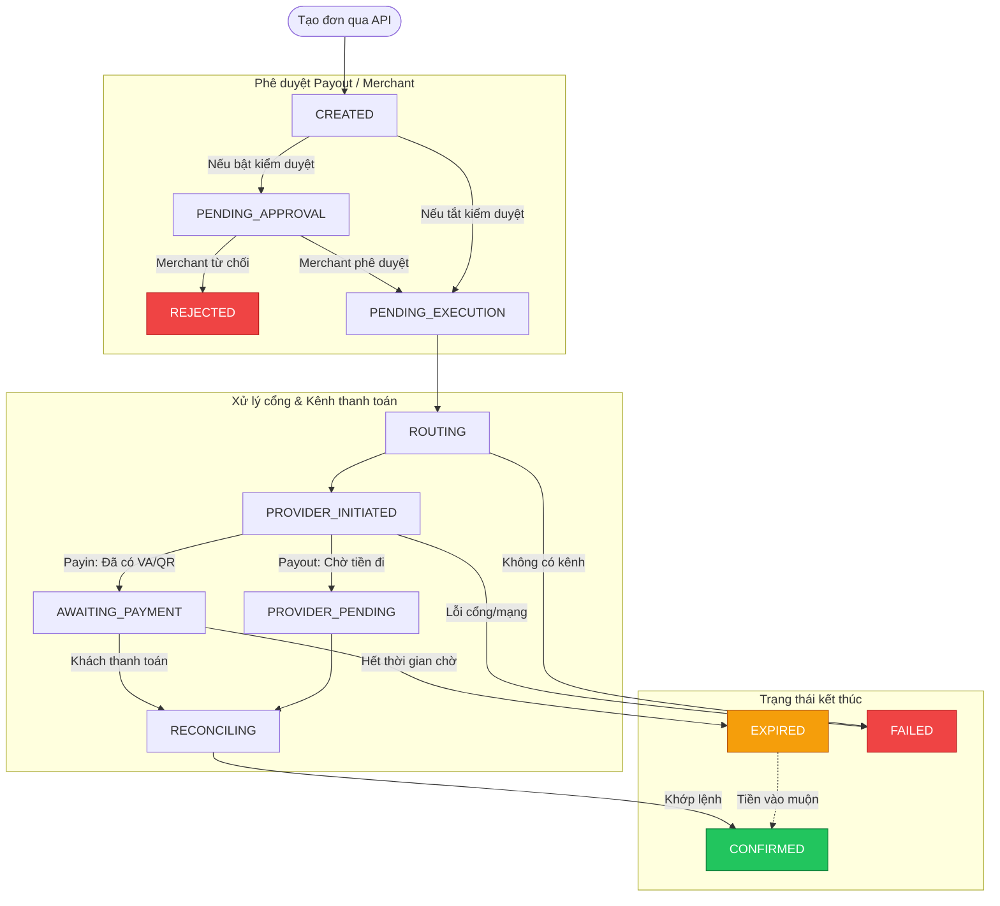
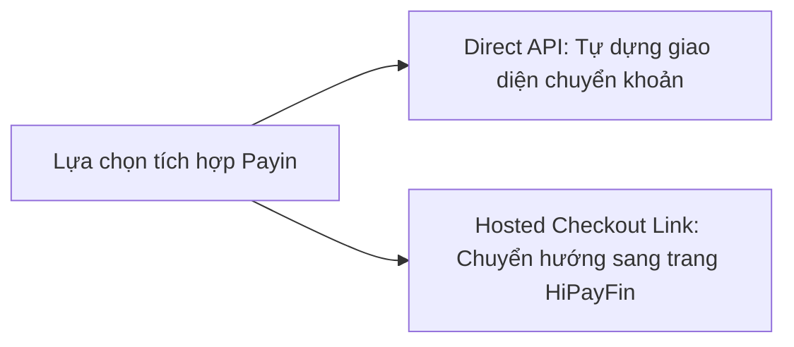
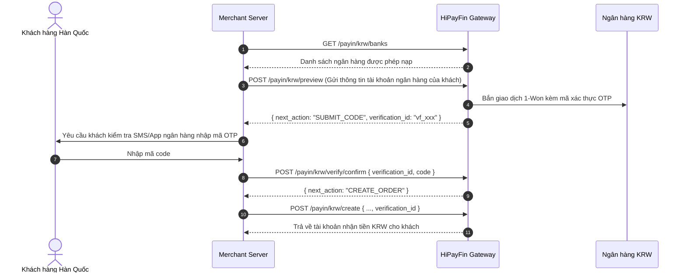
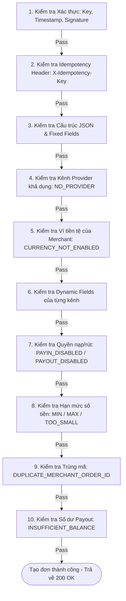

# TÀI LIỆU HƯỚNG DẪN TÍCH HỢP TOÀN DIỆN HIPAYFIN MERCHANT API
> **Phiên bản:** v1.0.0 (API v1)  
> **Hệ thống:** HiPayFin Merchant Payment Gateway (Server-to-Server)  
> **Ngôn ngữ tài liệu:** Tiếng Việt (Dành cho Đội ngũ Kỹ thuật & Lập trình viên)  
> **Nguồn tài liệu gốc:** [https://docs.hipayfin.com/docs](https://docs.hipayfin.com/docs)  
> **Ngày cập nhật:** Tháng 10/2026  

---

## MỤC LỤC

1. [Tổng quan hệ thống & Môi trường](#1-tổng-quan-hệ-thống--môi-trường)
2. [Nguyên tắc cốt lõi & Quy chuẩn dữ liệu](#2-nguyên-tắc-cốt-lõi--quy-chuẩn-dữ-liệu)
   - [Định dạng số tiền & Tiền tệ (Amounts & Currencies)](#21-định-dạng-số-tiền--tiền-tệ-amounts--currencies)
   - [Chuẩn Response Envelope](#22-chuẩn-response-envelope)
   - [Cơ chế Idempotency (Chống gửi trùng lệnh)](#23-cơ-chế-idempotency-chống-gửi-trùng-lệnh)
3. [Cơ chế Xác thực & Ký chữ ký số (Authentication & Request Signing)](#3-cơ-chế-xác-thực--ký-chữ-ký-số-authentication--request-signing)
   - [Quy chuẩn 3 Headers xác thực](#31-quy-chuẩn-3-headers-xác-thực)
   - [Thuật toán sinh chữ ký X-Signature](#32-thuật-toán-sinh-chữ-ký-x-signature)
   - [Mã nguồn mẫu ký chữ ký (Node.js/TS, Python, PHP)](#33-mã-nguồn-mẫu-ký-chữ-ký)
4. [Các trường dữ liệu động theo kênh (Dynamic Fields)](#4-các-trường-dữ-liệu-động-theo-kênh-dynamic-fields)
5. [Vòng đời & Bảng trạng thái Đơn hàng (Order Lifecycle)](#5-vòng-đời--bảng-trạng-thái-đơn-hàng-order-lifecycle)
6. [Quy trình tích hợp Payin (Thu tiền / Nạp tiền)](#6-quy-trình-tích-hợp-payin-thu-tiền--nạp-tiền)
   - [Luồng 1: Tích hợp trực tiếp (Direct API)](#61-luồng-1-tích-hợp-trực-tiếp-direct-api)
   - [Luồng 2: Hosted Checkout Link](#62-luồng-2-hosted-checkout-link)
   - [Quy trình xác thực người thanh toán KRW (KRW Payer Verification)](#63-quy-trình-xác-thực-người-thanh-toán-krw)
   - [Báo cáo bằng chứng giao dịch USDT (Evidence / tx_hash)](#64-báo-cáo-bằng-chứng-giao-dịch-usdt)
7. [Quy trình tích hợp Payout (Chi tiền / Rút tiền)](#7-quy-trình-tích-hợp-payout-chi-tiền--rút-tiền)
   - [Cơ chế quản lý số dư (Customer Balance & Backing Balance)](#71-cơ-chế-quản-lý-số-dư)
   - [Chế độ phê duyệt (Approval Mode)](#72-chế-độ-phê-duyệt-approval-mode)
   - [Luồng Direct Payout](#73-luồng-direct-payout)
   - [Luồng Hosted Payout Link](#74-luồng-hosted-payout-link)
8. [Chi tiết toàn bộ Endpoints (API Reference)](#8-chi-tiết-toàn-bộ-endpoints-api-reference)
   - [8.1. Nhóm Payin Endpoints](#81-nhóm-payin-endpoints)
   - [8.2. Nhóm Payout Endpoints](#82-nhóm-payout-endpoints)
   - [8.3. Nhóm Wallets Endpoints](#83-nhóm-wallets-endpoints)
   - [8.4. Nhóm Orders Endpoints](#84-nhóm-orders-endpoints)
9. [Cơ chế Webhook & Xử lý sự kiện Server-to-Server](#9-cơ-chế-webhook--xử-lý-sự-kiện-server-to-server)
   - [Cấu hình & Headers Webhook](#91-cấu-hình--headers-webhook)
   - [Xác thực chữ ký Webhook](#92-xác-thực-chữ-ký-webhook)
   - [Chi tiết 4 sự kiện Webhook (Payload mẫu)](#93-chi-tiết-4-sự-kiện-webhook)
   - [Chiến lược xây dựng Webhook Consumer an toàn](#94-chiến-lược-xây-dựng-webhook-consumer-an-toàn)
10. [Bảng mã lỗi toàn diện (Error Handling & Troubleshooting)](#10-bảng-mã-lỗi-toàn-diện-error-handling--troubleshooting)
11. [Giới hạn tốc độ gọi API (Rate Limits)](#11-giới-hạn-tốc-độ-gọi-api-rate-limits)
12. [Checklist kiểm tra trước khi Golive (Production Readiness)](#12-checklist-kiểm-tra-trước-khi-golive)

---

## 1. TỔNG QUAN HỆ THỐNG & MÔI TRƯỜNG

HiPayFin Merchant API là cổng giao tiếp **Server-to-Server** qua HTTPS, sử dụng định dạng dữ liệu **JSON**. Toàn bộ request gửi lên cổng đều phải được ký số điện tử (HMAC-SHA256) và mọi kết quả thanh toán/chi tiền đều được thông báo bất đồng bộ qua hệ thống Webhooks.

### 1.1. Môi trường kết nối (Base URL)
Mọi endpoint của API đều nằm dưới tiền tố đường dẫn `/api/v1`:

| Môi trường | Base URL | Mô tả |
| :--- | :--- | :--- |
| **Sandbox** | `https://api-sandbox.hipayfin.com/api/v1` | Môi trường thử nghiệm, giả lập thanh toán, không dùng tiền thật |
| **Production** | `https://api.hipayfin.com/api/v1` | Môi trường chạy thật (Được kích hoạt khi ký hợp đồng & bật ví) |

> **Lưu ý cấu hình:** Cấu trúc path của endpoint ở 2 môi trường là hoàn toàn giống nhau, lập trình viên chỉ cần thay đổi Base URL qua biến môi trường (`ENV`).

### 1.2. Bộ thông tin chứng thực (Credentials)
Khi khởi tạo tài khoản tích hợp, bộ phận vận hành (Operator) sẽ cấp cho bạn **3 thông tin mật bắt buộc**:
1. `API Key` (`X-Api-Key`): Khóa định danh merchant.
2. `HMAC Secret`: Khóa bí mật dùng để ký chữ ký cho tất cả các HTTP request từ server của bạn gửi sang HiPayFin.
3. `Webhook Signing Secret`: Khóa bí mật dùng để xác thực chữ ký của các Webhook event do HiPayFin gửi về server của bạn.

> ⚠️ **Bảo mật tuyệt đối:** Tuyệt đối không nhúng `API Key`, `HMAC Secret` hay `Webhook Secret` vào source code frontend (Client-side Web, Mobile App). Toàn bộ luồng gọi API bắt buộc phải thực hiện từ backend server.

---

## 2. NGUYÊN TẮC CỐT LÕI & QUY CHUẨN DỮ LIỆU

### 2.1. Định dạng số tiền & Tiền tệ (Amounts & Currencies)
Hệ thống HiPayFin áp dụng quy chuẩn tiền tệ cực kỳ nghiêm ngặt nhằm tránh các sai số float/double trong giao dịch tài chính:

1. **Luôn là chuỗi số nguyên (Integer String) ở đơn vị nhỏ nhất (Minor Unit):**
   - **TUYỆT ĐỐI KHÔNG** gửi số kiểu `number` (ví dụ `150000` hoặc `10.5` trong JSON). Phải gửi dạng chuỗi ký tự: `"150000"`.
   - Chuỗi số tiền phải khớp hoàn toàn với biểu thức chính quy: `^[1-9][0-9]*$` (Số nguyên dương, không có số 0 ở đầu, không có dấu phẩy `,` hay dấu chấm `.`).
   - Giá trị tối đa của số tiền không vượt quá $2^{53} - 1$ (`9007199254740991`).

2. **Bảng quy đổi Minor Units theo từng đồng tiền:**

| Tiền tệ | Số chữ số thập phân (Decimals) | Quy tắc Minor Unit | Ví dụ thực tế |
| :--- | :---: | :--- | :--- |
| **VND** | `0` | 1 VND = 1 minor unit | `₫150,000` ➔ `"150000"` |
| **KRW** | `0` | 1 KRW = 1 minor unit | `₩150,000` ➔ `"150000"` |
| **USDT** | `6` | 1 USDT = $10^6$ minor units | `10 USDT` ➔ `"10000000"`<br>`1.5 USDT` ➔ `"1500000"` |

3. **Khái niệm `wallet_currency` vs `rail_currency`:**
   - Mỗi lệnh mang 2 thông tin: `wallet_currency` (loại ví biến động số dư trên HiPayFin) và `rail_currency` (loại tiền tệ thực tế lưu chuyển trên kênh ngân hàng/blockchain).
   - **Hiện tại:** Cả Payin và Payout đều là **cùng loại tiền tệ (Same-currency)**: `rail_currency` luôn bằng `wallet_currency`, tỷ giá `rate` luôn trả về `null`.
   - Nhà phát triển luôn đọc trực tiếp `amount` và `wallet_currency` từ response/webhook thay vì tự gán cố định.

---

### 2.2. Chuẩn Response Envelope
Tất cả các API responses từ HiPayFin đều được bọc trong một chuẩn Envelope thống nhất.

#### A. Khi thành công (HTTP 200 / 2xx):
Trường `error` luôn là `null`, dữ liệu trả về nằm trong `data`:
```json
{
  "data": {
    "order_ref": "PI-2026092900201",
    "status": "CREATED",
    ...
  },
  "error": null
}
```

#### B. Khi có lỗi (HTTP 4xx / 5xx):
Trường `data` luôn là `null`, trường `error` và `code` chứa mã lỗi định danh dạng string, trường `meta` cung cấp ngữ cảnh chi tiết:
```json
{
  "data": null,
  "error": "VALIDATION_ERROR",
  "code": "VALIDATION_ERROR",
  "meta": {
    "details": [
      {
        "field": "amount",
        "message": "amount must match ^[1-9][0-9]*$"
      }
    ]
  }
}
```

> **Nguyên tắc code:** Luôn kiểm tra `if (response.error !== null)` trước khi xử lý dữ liệu.

---

### 2.3. Cơ chế Idempotency (Chống gửi trùng lệnh)
Để đảm bảo an toàn tuyệt đối khi mạng bị chập chờn, timeout hoặc retry, tất cả các request tạo lệnh ghi nhận tiền hoặc sinh link bắt buộc phải có header:
```http
X-Idempotency-Key: <UUID-v4>
```

#### Các endpoint bắt buộc có `X-Idempotency-Key`:
- `POST /payin/{vnd|usdt|krw}/create`
- `POST /payin/link`
- `POST /payout/{vnd|usdt|krw}/create`
- `POST /payout/link`

*(Nếu thiếu header này, hệ thống sẽ từ chối ngay lập tức với lỗi `400 IDEMPOTENCY_KEY_REQUIRED`).*

#### Cơ chế xử lý 2 lớp của HiPayFin:
1. **Trạng thái đang xử lý (`409 REQUEST_IN_PROGRESS`):**
   - Khi request đầu tiên đang chạy trong hệ thống mà nhận được request khác cùng `X-Idempotency-Key`, server trả về `409 REQUEST_IN_PROGRESS`.
   - **Xử lý:** Lập trình viên cần chờ vài giây rồi retry lại với **cùng** Idempotency Key.

2. **Lớp 1: Trong vòng 24 giờ trên cùng endpoint:**
   - Nếu request đầu tiên đã tạo đơn thành công (hoặc thất bại sau khi đã ghi nhận đơn): việc gửi lại cùng Idempotency Key sẽ trả về `409 DUPLICATE_REQUEST` kèm `meta.existing_id` chứa `order_ref` (đối với create) hoặc `session_token` (đối với link).
   - **Xử lý:** Backend dùng `meta.existing_id` gọi `GET /orders/{ref}` để kiểm tra trạng thái đơn hàng đã tạo, **không tạo lệnh mới**.
   - Nếu request đầu tiên bị lỗi validation trước khi tạo đơn: Idempotency Key được giải phóng, có thể gọi lại bình thường.

3. **Lớp 2: Sau 24 giờ hoặc gửi sang endpoint khác:**
   - Nếu `merchant_order_id` đã từng được gán cho một đơn hàng trước đó: server trả về `409 DUPLICATE_MERCHANT_ORDER_ID`. Dùng `GET /orders?merchant_order_id=...` để tra cứu lại.
   - Nếu Idempotency Key này đã bị gắn chết với một đơn hàng khác (khác amount, currency, customer): server trả về `409 IDEMPOTENCY_MISMATCH`. Phải tạo key mới.

#### ⚠️ Phân biệt Idempotency Key và merchant_order_id:
- `X-Idempotency-Key`: Bảo vệ tầng network/transport (chống retry HTTP trùng lặp).
- `merchant_order_id`: Mã đơn hàng duy nhất trong nghiệp vụ của bạn (chống duplicate đơn hàng nội bộ).

---

## 3. CƠ CHẾ XÁC THỰC & KÝ CHỮ KÝ SỐ (AUTHENTICATION & REQUEST SIGNING)

### 3.1. Quy chuẩn 3 Headers xác thực
Mỗi HTTP request gửi đến HiPayFin bắt buộc phải kèm 3 headers sau:

| Header | Kiểu dữ liệu | Ý nghĩa & Quy cách |
| :--- | :--- | :--- |
| `X-Api-Key` | String | API Key của bạn do operator cấp |
| `X-Timestamp` | String / Integer | Thời gian Unix epoch tính bằng **giây** (Seconds) tại thời điểm tạo request |
| `X-Signature` | String | Chữ ký HMAC-SHA256 có tiền tố `sha256=` và chuỗi hash hex viết thường |

> ⚠️ **Quy định lệch giờ:** Máy chủ HiPayFin sẽ từ chối request có `X-Timestamp` lệch quá **±300 giây (5 phút)** so với giờ hệ thống (`401 TIMESTAMP_OUT_OF_RANGE`). Hãy đảm bảo server của bạn được đồng bộ NTP.
>
> ⚠️ **Yêu cầu đối với POST:** Mọi request POST **BẮT BUỘC** phải có header `Content-Type: application/json`. Nếu thiếu hoặc gửi JSON sai cú pháp, request sẽ bị trả về `400 VALIDATION_ERROR` hoặc `401 SIGNATURE_INVALID` trước khi đọc body.

---

### 3.2. Thuật toán sinh chữ ký X-Signature
Chữ ký được tạo bằng thuật toán HMAC-SHA256 sử dụng `HMAC Secret` được cấp:

```
PayloadToSign = X-Timestamp + "." + rawBody
SignatureHex  = HMAC_SHA256(hmac_secret, PayloadToSign)
X-Signature   = "sha256=" + lowercase(SignatureHex)
```

#### Quy tắc cực kỳ quan trọng:
1. **Đối với POST Request:** `rawBody` là **chuỗi JSON nguyên bản (Raw String)** chuẩn bị gửi qua mạng. Không được format lại hay parse/stringify làm thay đổi khoảng trắng sau khi đã ký.
2. **Đối với GET Request:** Vì GET không có body, `rawBody` là chuỗi rỗng `""`.  
   👉 Khi đó, chuỗi cần ký chính là: `X-Timestamp + "."` (Có dấu chấm ở cuối!). Ví dụ: `"1728719200."`.
3. Chuỗi hash hex **bắt buộc phải là chữ thường** (`lowercase`).
4. Tiền tố `"sha256="` là bắt buộc.

---

### 3.3. Mã nguồn mẫu ký chữ ký

#### Node.js / TypeScript
```typescript
import crypto from 'node:crypto';

export interface SignedHeaders {
  'X-Api-Key': string;
  'X-Timestamp': string;
  'X-Signature': string;
  'Content-Type': string;
  'X-Idempotency-Key'?: string;
}

export function buildSignedHeaders(params: {
  apiKey: string;
  hmacSecret: string;
  body?: object | string | null;
  idempotencyKey?: string;
}): { headers: SignedHeaders; bodyString: string } {
  const timestamp = Math.floor(Date.now() / 1000).toString();
  
  // Chuẩn hóa rawBody: rỗng cho GET, stringify cho POST
  let bodyString = '';
  if (params.body !== undefined && params.body !== null) {
    bodyString = typeof params.body === 'string' ? params.body : JSON.stringify(params.body);
  }

  // Chuỗi cần ký: {timestamp}.{rawBody}
  const payloadToSign = `${timestamp}.${bodyString}`;
  const hmac = crypto.createHmac('sha256', params.hmacSecret);
  hmac.update(payloadToSign);
  const signature = 'sha256=' + hmac.digest('hex').toLowerCase();

  const headers: SignedHeaders = {
    'X-Api-Key': params.apiKey,
    'X-Timestamp': timestamp,
    'X-Signature': signature,
    'Content-Type': 'application/json',
  };

  if (params.idempotencyKey) {
    headers['X-Idempotency-Key'] = params.idempotencyKey;
  }

  return { headers, bodyString };
}
```

#### Python 3
```python
import hmac
import hashlib
import time
import json
from typing import Optional, Dict, Tuple, Any

def build_signed_headers(
    api_key: str,
    hmac_secret: str,
    body: Optional[Any] = None,
    idempotency_key: Optional[str] = None
) -> Tuple[Dict[str, str], str]:
    timestamp = str(int(time.time()))
    
    # Chuẩn hoá raw body
    if body is not None:
        body_string = body if isinstance(body, str) else json.dumps(body, separators=(',', ':'))
    else:
        body_string = ""
        
    payload_to_sign = f"{timestamp}.{body_string}"
    
    signature_hash = hmac.new(
        hmac_secret.encode('utf-8'),
        payload_to_sign.encode('utf-8'),
        hashlib.sha256
    ).hexdigest().lower()
    
    headers = {
        "X-Api-Key": api_key,
        "X-Timestamp": timestamp,
        "X-Signature": f"sha256={signature_hash}",
        "Content-Type": "application/json"
    }
    
    if idempotency_key:
        headers["X-Idempotency-Key"] = idempotency_key
        
    return headers, body_string
```

#### PHP (>= 7.4 / 8.x)
```php
function buildSignedHeaders(string $apiKey, string $hmacSecret, $body = null, ?string $idempotencyKey = null): array {
    $timestamp = (string)time();
    $rawBody = "";
    if ($body !== null) {
        $rawBody = is_string($body) ? $body : json_encode($body, JSON_UNESCAPED_SLASHES);
    }
    
    $payloadToSign = $timestamp . "." . $rawBody;
    $sigHex = hash_hmac('sha256', $payloadToSign, $hmacSecret);
    
    $headers = [
        "X-Api-Key: " . $apiKey,
        "X-Timestamp: " . $timestamp,
        "X-Signature: sha256=" . strtolower($sigHex),
        "Content-Type: application/json"
    ];
    
    if ($idempotencyKey) {
        $headers[] = "X-Idempotency-Key: " . $idempotencyKey;
    }
    
    return [$headers, $rawBody];
}
```

---

## 4. CÁC TRƯỜNG DỮ LIỆU ĐỘNG THEO KÊNH (DYNAMIC FIELDS)

Khi gọi API tạo đơn Payin hoặc Payout, request body bao gồm:
1. **Phần cố định (Fixed fields):** Mọi lệnh create đều phải có.
2. **Phần động (Dynamic fields):** Khác nhau tùy theo kênh tiền tệ (rail) và chiều thanh toán.

### 4.1. Phần dữ liệu cố định (Fixed Fields)
| Trường | Bắt buộc? | Kiểu | Giới hạn & Ghi chú |
| :--- | :---: | :--- | :--- |
| `merchant_order_id` | **Có** | String | Mã đơn hàng nội bộ của bạn (Tối đa 64 ký tự). Nếu trùng ➔ `409 DUPLICATE_MERCHANT_ORDER_ID`. |
| `merchant_customer_id` | **Có** | String | Mã định danh khách hàng trên hệ thống của bạn (Tối đa 64 ký tự). |
| `amount` | **Có** | String | Số tiền Minor unit, ví dụ: `"150000"` (Regex: `^[1-9][0-9]*$`). |
| `customer_name` | Không | String | Tên hiển thị của khách hàng. **Lưu ý:** Nếu không có, hãy bỏ hẳn trường này ra khỏi JSON, **không gửi chuỗi rỗng `""`** (sẽ bị lỗi `400 VALIDATION_ERROR`). |

### 4.2. Phần dữ liệu động (Dynamic Fields) theo kênh

> ⚠️ **Quy tắc Strict Validation:** Hệ thống kiểm tra cấu trúc cực kỳ chặt chẽ. **Không gửi thừa bất kỳ trường nào** ngoài danh sách quy định bên dưới cho kênh tương ứng. Gửi thừa trường sẽ bị trả về `400 VALIDATION_ERROR`.

| Nghiệp vụ & Kênh | Dynamic Fields lúc tạo đơn (`.../create`) | Chi tiết & Định dạng |
| :--- | :--- | :--- |
| **VND Payin** | *Không có* | Chỉ gửi Fixed Fields. |
| **USDT Payin** | *Không có lúc create* | Tạo đơn chỉ cần Fixed Fields. Bằng chứng giao dịch on-chain (`tx_hash`) được gửi sau qua endpoint evidence. |
| **KRW Payin** | - `sender_account_name`<br>- `sender_name_kr`<br>- `sender_bank_code`<br>- `sender_account_number`<br>- `sender_dob`<br>- `verification_id` | • `sender_account_name`: 2–100 ký tự.<br>• `sender_name_kr`: Tên tiếng Hàn 1–100 ký tự.<br>• `sender_bank_code`: Mã ngân hàng từ `GET /payin/krw/banks` (VD: `KOOKMIN`).<br>• `sender_account_number`: 4–20 chữ số (chỉ số, không khoảng trắng/gạch nối).<br>• `sender_dob`: Ngày sinh dạng YYMMDD (đúng 6 chữ số, ví dụ `970101`).<br>• Bắt buộc phải qua bước xác thực trước. |
| **VND Payout** | - `bank_code`<br>- `account_number`<br>- `account_holder` | • `bank_code`: Mã ngân hàng từ `GET /payout/vnd/banks` (VD: `"970436"` cho Vietcombank).<br>• `account_number`: Số tài khoản nhận tiền (4–20 số, chỉ chữ số).<br>• `account_holder`: Tên chủ tài khoản nhận (2–100 ký tự). |
| **USDT Payout** | - `wallet_address`<br>- `network` | • `wallet_address`: Địa chỉ ví TRON TRC20 hợp lệ (Bắt đầu bằng chữ `T`, tổng cộng 34 ký tự base58).<br>• `network`: Cố định giá trị `"TRC20"`. |
| **KRW Payout** | - `bank_name`<br>- `account_number`<br>- `account_holder`<br>- `customer_name_kr` | • `bank_name`: Tên ngân hàng dạng tự do (Free-text 2–100 ký tự, ví dụ `"KB"`).<br>• `account_number`: Số tài khoản 4–20 số.<br>• `account_holder`: Tên chủ tài khoản 2–100 ký tự.<br>• `customer_name_kr`: Tên khách hàng tiếng Hàn (1–100 ký tự). |

---

## 5. VÒNG ĐỜI & BẢNG TRẠNG THÁI ĐƠN HÀNG (ORDER LIFECYCLE)

### 5.1. Bảng tra cứu toàn bộ trạng thái đơn hàng (Order Statuses)

| Trạng thái | Ý nghĩa | Trạng thái cuối? (Terminal) |
| :--- | :--- | :---: |
| `CREATED` | Đơn hàng đã được tạo thành công, chờ chuyển vào hàng đợi xử lý | Không |
| `PENDING_APPROVAL` | Đơn hàng đang tạm dừng chờ nhân viên của Merchant duyệt trên Merchant Portal (Mặc định ở Payout, hoặc khi số dư bảo chứng thiếu) | Không |
| `PENDING_EXECUTION` | Đơn hàng đang chờ nhân viên vận hành của HiPayFin phê duyệt xuất tiền | Không |
| `ROUTING` | Hệ thống đang phân bổ kênh xử lý thanh toán phù hợp | Không |
| `PROVIDER_INITIATED` | Đã gửi lệnh sang cổng đối tác: Payin đang sinh hướng dẫn/VA; Payout đang thực hiện lệnh chuyển khoản | Không |
| `AWAITING_PAYMENT` | Hướng dẫn thanh toán (Tài khoản ảo, mã QR, STK) đã sẵn sàng, đang chờ người dùng chuyển tiền | Không |
| `PROVIDER_PENDING` | Giao dịch đang chờ ngân hàng/blockchain xử lý tiếp | Không |
| `RECONCILING` | Đã nhận được báo có, hệ thống đang đối soát dữ liệu với đơn hàng | Không |
| `HELD` | Đơn hàng bị tạm giữ để quản trị viên kiểm tra an toàn | Không |
| `CONFIRMED` | **Giao dịch thành công hoàn tất.** Tiền Payin đã cộng vào ví, hoặc tiền Payout đã chuyển thành công đến khách | **CÓ** |
| `FAILED` | Giao dịch thất bại (Lỗi provider, từ chối xử lý, sai cấu hình, v.v.) | **CÓ** |
| `EXPIRED` | Đơn hàng hết hạn thanh toán (Quá thời gian cho phép mà khách chưa chuyển) | **CÓ\*** |
| `REJECTED` | Đơn bị từ chối/hủy bởi Merchant hoặc Operator tại bước Approval | **CÓ** |
| `REVERSED` | Đơn hàng đã CONFIRMED trước đó nhưng bị đảo ngược giao dịch do khiếu nại/điều chỉnh | **CÓ** |

> 💡 **Lưu ý quan trọng về trạng thái `EXPIRED`:**  
> Nếu một đơn hàng Payin bị chuyển sang `EXPIRED`, nhưng sau đó tiền của khách vẫn tới tài khoản ngân hàng của cổng, HiPayFin vẫn sẽ ghi có đơn hàng và gửi webhook `payment.confirmed` về sau! Do đó, backend của bạn cần thiết kế để vẫn chấp nhận webhook `payment.confirmed` cho đơn hàng dù đơn đó đang tạm ở trạng thái `EXPIRED`.

### 5.2. Sơ đồ trạng thái chuyển dịch (State Transition Flowchart)



---

## 6. QUY TRÌNH TÍCH HỢP PAYIN (THU TIỀN / NẠP TIỀN)

HiPayFin cung cấp 2 phương thức tích hợp thu tiền tùy thuộc vào trải nghiệm người dùng bạn muốn xây dựng:



---

### 6.1. Luồng 1: Tích hợp trực tiếp (Direct API)
Phù hợp khi bạn muốn tự vẽ giao diện hiển thị QR Code, số tài khoản ngân hàng trên ứng dụng/website của mình.

#### Bước 1: Gọi API tạo đơn Payin
- Endpoint VND: `POST /api/v1/payin/vnd/create`
- Endpoint USDT: `POST /api/v1/payin/usdt/create`
- Header: `X-Idempotency-Key: <UUID>`

**Request Body mẫu (VND):**
```json
{
  "merchant_order_id": "ORD-VN-20261012-001",
  "merchant_customer_id": "USER-9921",
  "amount": "250000",
  "customer_name": "Nguyen Van A"
}
```

**Response trả về (HTTP 200):**
```json
{
  "data": {
    "order_ref": "PI-2026101200088",
    "status": "CREATED",
    "instruction": {
      "kind": "VA",
      "bank": "Vietcombank",
      "account": "998822334455",
      "holder": "CONG TY TNHH ABC",
      "reference": "PI2026101200088",
      "qrData": "00020101021238540010A0000007270124000697043601149988223344555204..."
    },
    "expires_at": "2026-10-12T07:15:00.000Z"
  },
  "error": null
}
```

> ⚠️ **Lưu ý về `instruction`:**
> Đôi khi đơn hàng vừa tạo có thể ở trạng thái xử lý ban đầu và `instruction` trả về là `null`. Khi đó, backend của bạn cần poll nhẹ `GET /api/v1/orders/{ref}` cho đến khi `instruction` khác `null` để lấy thông tin tài khoản hiển thị cho khách hàng.

#### Bước 2: Hiển thị hướng dẫn cho khách hàng
- Sử dụng `instruction.qrData` để hiển thị VietQR (đối với VND).
- Hiển thị `instruction.bank`, `instruction.account`, `instruction.holder`, `instruction.reference` (Nội dung chuyển khoản bắt buộc).
- Cảnh báo khách hàng chuyển đúng số tiền và nội dung chuyển khoản trước thời điểm `expires_at`.

#### Bước 3: Chờ nhận kết quả qua Webhook
Khi khách hàng thanh toán thành công, HiPayFin sẽ bắn webhook `payment.confirmed` về server của bạn.

---

### 6.2. Luồng 2: Hosted Checkout Link
Dành cho merchant muốn tích hợp nhanh chóng mà không cần tự xử lý giao diện ngân hàng hay sinh mã VietQR.

#### Bước 1: Mint Hosted Link qua API
- Endpoint: `POST /api/v1/payin/link`
- Header: `X-Idempotency-Key: <UUID>`

**Request Body:**
```json
{
  "merchant_order_id": "ORD-LINK-20261012-01",
  "merchant_customer_id": "USER-9921",
  "amount": "500000",
  "target_currency": "VND"
}
```

**Response:**
```json
{
  "data": {
    "session_token": "sess_payin_a8c2f10b7e41",
    "hosted_page_url": "https://pay.hipayfin.com/payin/sess_payin_a8c2f10b7e41",
    "expires_at": "2026-10-12T07:15:00.000Z"
  },
  "error": null
}
```

#### Bước 2: Redirect khách hàng
Redirect khách hàng tới `hosted_page_url`. Trang thanh toán của HiPayFin sẽ tự động hiển thị QR, STK và tự động đếm ngược thời gian thanh toán (15 phút).

#### Lưu ý quan trọng khi Mint Link:
1. **Thời hạn link:** Link hết hạn sau **15 phút**.
2. **Tái tạo link (Re-minting):** Nếu khách làm mất link hoặc link hết hạn, bạn có thể gọi lại `POST /payin/link` với **cùng `merchant_order_id`** nhưng với **một `X-Idempotency-Key` mới** để lấy URL mới. (Link cũ sẽ lập tức bị vô hiệu hóa).
3. **Idempotency với Link:** Nếu retry cùng `X-Idempotency-Key`, server trả về `409 DUPLICATE_REQUEST` với `meta.existing_id` là `session_token`. Giá trị này không thể dùng để khôi phục URL đã mất, do đó hãy áp dụng quy tắc tạo key mới như mục 2 ở trên.

---

### 6.3. Quy trình xác thực người thanh toán KRW (KRW Payer Verification)
Kênh nạp tiền Won Hàn Quốc (KRW) yêu cầu quy trình xác minh danh tính người chuyển khoản (Payer Verification) trước khi cho phép tạo đơn nạp tiền:



#### Các trạng thái `next_action` trong xác thực KRW:
- `SUBMIT_CODE`: Cần yêu cầu khách nhập mã xác minh (kèm `remaining_attempts: 2` hoặc `1`).
- `CREATE_ORDER`: Xác minh thành công, gọi `.../create` kèm `verification_id`.
- `RESTART`: Lượt xác minh thất bại hoàn toàn (do sai quá 3 lần `CODE_MISMATCH` hoặc `EXPIRED`). Phải bắt đầu lại từ `.../preview`.

---

### 6.4. Báo cáo bằng chứng giao dịch USDT (Evidence / tx_hash)
Đối với kênh nạp tiền bằng Crypto (USDT - TRC20):
1. Khi gọi `POST /payin/usdt/create`, đơn hàng được tạo và cung cấp địa chỉ ví nhận USDT.
2. Sau khi khách hàng chuyển tiền trên blockchain TRON, bạn cần gửi mã giao dịch on-chain về hệ thống qua endpoint:
   - Endpoint: `POST /api/v1/orders/{ref}/evidence`
   - Path param: `{ref}` là `order_ref` của đơn hàng (VD: `PI-2026101200088`).

**Request Body:**
```json
{
  "tx_hash": "5e1c0d892f3a4b5c6d7e8f90123456789abcdef0123456789abcdef012345678"
}
```

#### Quy tắc về `tx_hash`:
- Chấp nhận: Chuỗi hex 64 ký tự, có hoặc không có tiền tố `0x`, hoặc đường dẫn URL TRON block-explorer (`https://tronscan.org/#/transaction/...`).
- Hệ thống sẽ chuẩn hóa lưu dạng 64 ký tự hex chữ thường.
- `tx_hash` phải là duy nhất trên toàn hệ thống. Nếu mã băm đã từng được dùng trên bất kỳ đơn nào khác ➔ Lỗi `409 DUPLICATE_TX_HASH`.
- Nếu đơn hàng đã kết thúc (CONFIRMED, FAILED, EXPIRED) ➔ Lỗi `409 ORDER_ALREADY_FINAL`.

---

## 7. QUY TRÌNH TÍCH HỢP PAYOUT (CHI TIỀN / RÚT TIỀN)

### 7.1. Cơ chế quản lý số dư (Balance Checks)
Khi thực hiện một lệnh Payout, HiPayFin kiểm tra **2 tầng số dư độc lập** (Cả 2 số dư này đều không công khai qua API):

1. **Số dư Khách hàng (Customer Balance):**
   - Mỗi `merchant_customer_id` có một tài khoản số dư riêng biệt theo từng loại tiền tệ, được cộng lũy kế từ các giao dịch Payin thành công của chính khách hàng đó.
   - Khi Payout, hệ thống bắt buộc kiểm tra: `Customer Balance - Số tiền các Payout đang chờ >= Số tiền rút`.
   - Nếu không đủ số dư khách hàng ➔ Trả về lỗi `409 INSUFFICIENT_BALANCE`.
   - 👉 **Nguyên tắc:** Khi Payout cho khách hàng nào, bắt buộc phải dùng đúng `merchant_customer_id` đã từng Payin trước đó.
2. **Số dư Bảo chứng của Merchant (Backing Balance):**
   - Tài khoản ví bảo lãnh của bạn trên HiPayFin phải đủ chi trả `Số tiền rút + Phí giao dịch`.
   - Nếu số dư bảo chứng chưa đủ, lệnh rút **KHÔNG BỊ TỪ CHỐI**, mà sẽ dừng lại ở trạng thái `PENDING_APPROVAL` để kế toán/nhân viên của bạn nạp thêm tiền bảo lãnh và bấm duyệt trên Merchant Portal.

---

### 7.2. Chế độ phê duyệt (Approval Mode)
Mặc định hệ thống thiết lập chế độ **Duyệt thủ công (Manual Approval)**:
- Mọi lệnh Payout tạo qua API sẽ trả về HTTP 200 với trạng thái `status: "PENDING_APPROVAL"`.
- Đơn hàng sẽ xuất hiện trong danh sách Chờ duyệt trên **Merchant Portal** để nhân sự được cấp quyền vào kiểm tra và nhấn Approve/Reject.
- *(Nếu doanh nghiệp của bạn yêu cầu tự động chi 100% không qua duyệt tay, hãy liên hệ Operator để cấu hình tắt Manual Approval cho tài khoản)*.

---

### 7.3. Luồng Direct Payout (Chi trực tiếp)

#### Bước 1: (Tùy chọn) Kiểm tra danh sách ngân hàng hợp lệ
- Endpoint: `GET /api/v1/payout/vnd/banks`
- Trả về danh sách `code` (ví dụ `"970436"` - Vietcombank) để bạn hiển thị danh sách chọn ngân hàng trên app của bạn.

#### Bước 2: Khởi tạo lệnh Payout qua API
- Endpoint VND: `POST /api/v1/payout/vnd/create`
- Header: `X-Idempotency-Key: <UUID>`

**Request Body (VND Payout):**
```json
{
  "merchant_order_id": "PO-VN-20261012-001",
  "merchant_customer_id": "USER-9921",
  "amount": "150000",
  "bank_code": "970436",
  "account_number": "0071001234567",
  "account_holder": "TRAN THI B"
}
```

**Response (HTTP 200):**
```json
{
  "data": {
    "order_ref": "PO-2026101200045",
    "status": "PENDING_APPROVAL"
  },
  "error": null
}
```

#### Bước 3: Trạng thái chờ xử lý & Kết quả
- Đơn chuyển sang `PENDING_EXECUTION` (Chờ cổng đẩy lệnh ngân hàng) hoặc `PROVIDER_INITIATED`.
- **Lưu ý sự cố mạng (Timeout / No verdict):**  
  Nếu cổng thanh toán gặp lỗi timeout chưa rõ tiền đã chuyển hay chưa, đơn hàng sẽ giữ nguyên ở `PROVIDER_INITIATED` với `outcome_unknown: true` (tiền bị giữ tạm thời, **KHÔNG BAO GIỜ TỰ ĐỘNG CHUYỂN SANG FAILED**).  
  ⚠️ **CẢNH BÁO:** Tuyệt đối không tự động tạo lại lệnh rút tiền mới! Hãy định kỳ gọi `GET /api/v1/orders/{ref}` hoặc đợi webhook `payout.processed` / `payout.blocked`.

---

### 7.4. Luồng Hosted Payout Link
Cho phép gửi 1 đường link cho người nhận tự điền thông tin tài khoản ngân hàng hoặc địa chỉ ví crypto của họ:
- Endpoint: `POST /api/v1/payout/link`
- Body: `{ "merchant_order_id": "...", "merchant_customer_id": "...", "amount": "150000", "currency": "USDT" }`
- Trả về: `hosted_link_url` (Hết hạn sau 15 phút).

---

## 8. CHI TIẾT TOÀN BỘ ENDPOINTS (API REFERENCE)

Tất cả các endpoint bên dưới đều kế thừa Base URL: `https://api.hipayfin.com/api/v1` (hoặc `https://api-sandbox.hipayfin.com/api/v1`).

---

### 8.1. Nhóm Payin Endpoints

#### 1. Lấy danh sách ngân hàng xác thực người nạp tiền
- **Method & Path:** `GET /payin/{cur}/banks` (`cur` = `krw` | `vnd` | `usdt`)
- **Headers:** `X-Api-Key`, `X-Timestamp`, `X-Signature`
- **Mô tả:** Đối với KRW, trả về danh sách ngân hàng được phép xác thực (e.g. `KOOKMIN`, `SHINHAN`). Đối với VND và USDT, trường `banks` trả về `null` vì không yêu cầu danh sách đóng.
- **Response 200 (KRW):**
```json
{
  "data": {
    "currency": "KRW",
    "field": "sender_bank_code",
    "banks": [
      { "code": "KOOKMIN", "name": "KB국민은행", "verifiable": true },
      { "code": "SHINHAN", "name": "신한은행", "verifiable": true }
    ]
  },
  "error": null
}
```

#### 2. Xem trước / Bắt đầu xác thực người nạp tiền KRW
- **Method & Path:** `POST /payin/{cur}/preview`
- **Headers:** `X-Api-Key`, `X-Timestamp`, `X-Signature`, `Content-Type: application/json`
- **Body (KRW):**
```json
{
  "merchant_customer_id": "cust_1001",
  "amount": "500000",
  "sender_account_name": "Hong Gildong",
  "sender_name_kr": "홍길동",
  "sender_bank_code": "KOOKMIN",
  "sender_account_number": "11012345678",
  "sender_dob": "970101"
}
```
- **Response 200:**
```json
{
  "data": {
    "next_action": "SUBMIT_CODE",
    "verification_id": "vf_9f2a1c",
    "expires_at": "2026-10-12T10:15:00.000Z"
  },
  "error": null
}
```

#### 3. Xác nhận mã code xác thực KRW
- **Method & Path:** `POST /payin/{cur}/verify/confirm`
- **Headers:** Chuẩn Auth headers
- **Body:** `{ "verification_id": "vf_9f2a1c", "code": "1234" }`
- **Response 200:**
```json
{
  "data": {
    "next_action": "CREATE_ORDER"
  },
  "error": null
}
```

#### 4. Khởi tạo đơn nạp tiền (Create Payin Order)
- **Method & Path:**
  - `POST /payin/vnd/create`
  - `POST /payin/usdt/create`
  - `POST /payin/krw/create`
- **Headers:** Chuẩn Auth headers + `X-Idempotency-Key: <UUID>`
- **Body ví dụ (USDT):**
```json
{
  "merchant_order_id": "PI-USDT-001",
  "merchant_customer_id": "CUST-888",
  "amount": "100000000" 
}
```
*(100,000,000 minor units = 100 USDT)*
- **Response 200:**
```json
{
  "data": {
    "order_ref": "PI-2026101200999",
    "status": "CREATED",
    "instruction": {
      "kind": "CRYPTO_ADDRESS",
      "address": "TXYZaBcDeFgHiJkLmNoPqRsTuVwXyZ1234",
      "network": "TRC20"
    },
    "expires_at": "2026-10-12T07:30:00.000Z"
  },
  "error": null
}
```

#### 5. Sinh Hosted Payin Link
- **Method & Path:** `POST /payin/link`
- **Headers:** Chuẩn Auth headers + `X-Idempotency-Key: <UUID>`
- **Body:**
```json
{
  "merchant_order_id": "INV-2026-001",
  "merchant_customer_id": "CUST-123",
  "amount": "200000",
  "target_currency": "VND"
}
```
- **Response 200:**
```json
{
  "data": {
    "session_token": "tok_pi_12345678",
    "hosted_page_url": "https://pay.hipayfin.com/payin/tok_pi_12345678",
    "expires_at": "2026-10-12T07:15:00.000Z"
  },
  "error": null
}
```

---

### 8.2. Nhóm Payout Endpoints

#### 1. Lấy danh sách ngân hàng nhận Payout
- **Method & Path:** `GET /payout/{cur}/banks` (`cur` = `vnd` | `usdt` | `krw`)
- **Headers:** Chuẩn Auth headers
- **Response 200 (VND):**
```json
{
  "data": {
    "currency": "VND",
    "field": "bank_code",
    "banks": [
      { "code": "970436", "name": "Vietcombank (VCB)" },
      { "code": "970418", "name": "BIDV (BIDV)" },
      { "code": "970415", "name": "VietinBank (CTG)" },
      { "code": "970407", "name": "Techcombank (TCB)" }
    ]
  },
  "error": null
}
```

#### 2. Xem trước / Báo giá số tiền thực nhận Payout
- **Method & Path:** `POST /payout/{cur}/preview`
- **Body:** `{ "amount": "150000" }`
- **Response 200:**
```json
{
  "data": {
    "receive_currency": "VND",
    "receive_amount": "150000"
  },
  "error": null
}
```

#### 3. Tạo lệnh rút tiền Payout
- **Method & Path:**
  - `POST /payout/vnd/create`
  - `POST /payout/usdt/create`
  - `POST /payout/krw/create`
- **Headers:** Chuẩn Auth headers + `X-Idempotency-Key: <UUID>`
- **Body mẫu (USDT Payout):**
```json
{
  "merchant_order_id": "PO-USDT-9901",
  "merchant_customer_id": "USER-9921",
  "amount": "50000000",
  "wallet_address": "TLyqzVGLV1srkB7dToTApwdQEguDXHubQh",
  "network": "TRC20"
}
```
- **Response 200:**
```json
{
  "data": {
    "order_ref": "PO-2026101200102",
    "status": "PENDING_APPROVAL"
  },
  "error": null
}
```

#### 4. Sinh Hosted Payout Link
- **Method & Path:** `POST /payout/link`
- **Headers:** Chuẩn Auth headers + `X-Idempotency-Key: <UUID>`
- **Body:**
```json
{
  "merchant_order_id": "PO-LINK-001",
  "merchant_customer_id": "USER-9921",
  "amount": "100000000",
  "currency": "USDT"
}
```
- **Response 200:**
```json
{
  "data": {
    "session_token": "tok_po_887766",
    "hosted_link_url": "https://pay.hipayfin.com/payout/tok_po_887766",
    "expires_at": "2026-10-12T07:15:00.000Z"
  },
  "error": null
}
```

---

### 8.3. Nhóm Wallets Endpoints

#### Danh sách ví của Merchant
- **Method & Path:** `GET /wallets`
- **Headers:** Chuẩn Auth headers
- **Mô tả:** Kiểm tra các đồng tiền đang được kích hoạt trên tài khoản Merchant của bạn. (Lưu ý: API không trả số dư bảo chứng nhạy cảm, chỉ trả trạng thái).
- **Response 200:**
```json
{
  "data": [
    { "currency": "VND", "status": "ACTIVE" },
    { "currency": "USDT", "status": "ACTIVE" },
    { "currency": "KRW", "status": "ACTIVE" }
  ],
  "error": null
}
```

---

### 8.4. Nhóm Orders Endpoints

#### 1. Lấy thông tin đơn hàng theo `order_ref`
- **Method & Path:** `GET /orders/{ref}`
- **Headers:** Chuẩn Auth headers
- **Path parameter:** `ref` là mã đơn hàng của HiPayFin (bắt đầu bằng `PI-...` hoặc `PO-...`).
- **Response 200:**
```json
{
  "data": {
    "order_ref": "PI-2026101200088",
    "merchant_order_id": "ORD-VN-20261012-001",
    "kind": "PAYIN",
    "status": "CONFIRMED",
    "wallet_currency": "VND",
    "rail_currency": "VND",
    "amount": "250000",
    "fee": "2500",
    "rate": null,
    "created_at": "2026-10-12T06:55:00.000Z",
    "confirmed_at": "2026-10-12T07:02:15.000Z",
    "outcome_unknown": false,
    "instruction": {
      "kind": "VA",
      "bank": "Vietcombank",
      "account": "998822334455",
      "holder": "CONG TY TNHH ABC",
      "reference": "PI2026101200088"
    }
  },
  "error": null
}
```

#### 2. Tìm kiếm đơn hàng theo `merchant_order_id`
- **Method & Path:** `GET /orders?merchant_order_id={merchant_order_id}`
- **Headers:** Chuẩn Auth headers
- **Mô tả:** Cứu cánh trong trường hợp mạng bị timeout khi gọi create mà server của bạn chưa kịp lưu `order_ref`.
- **Response 200:** Định dạng giống hệt `GET /orders/{ref}`.

#### 3. Báo cáo bằng chứng giao dịch (Report Evidence)
- **Method & Path:** `POST /orders/{ref}/evidence`
- **Headers:** Chuẩn Auth headers + `Content-Type: application/json`
- **Path parameter:** `ref` là `order_ref` của đơn Payin (ví dụ USDT).
- **Body:** `{ "tx_hash": "5e1c0d892f3a4b5c6d7e8f90123456789abcdef0123456789abcdef012345678" }`
- **Response 200:**
```json
{
  "data": {
    "order_ref": "PI-2026101200088",
    "transfer_reported_at": "2026-10-12T07:05:00.000Z"
  },
  "error": null
}
```

---

## 9. CƠ CHẾ WEBHOOK & XỬ LÝ SỰ KIỆN SERVER-TO-SERVER

Webhook là cơ chế quan trọng nhất để hệ thống của bạn nhận thông báo trạng thái giao dịch một cách tức thì và tự động.

### 9.1. Cấu hình & Headers Webhook
- Cung cấp cho Operator một URL nhận Webhook HTTPS trên server của bạn (Ví dụ: `https://api.yourdomain.com/webhooks/hipayfin`).
- Operator sẽ cấp cho bạn một **`Webhook Signing Secret`** (Độc lập với HMAC Secret dùng để gọi API).
- Bật đầy đủ cả **4 sự kiện Webhook** trên hệ thống.

Mỗi Webhook request gửi từ HiPayFin tới server của bạn luôn mang 4 headers:

| Header | Mô tả |
| :--- | :--- |
| `X-Webhook-Id` | ID duy nhất của lượt gửi này (Trùng với `event_id` trong body) |
| `X-Webhook-Timestamp` | Thời gian gửi tính bằng Unix epoch seconds |
| `X-Webhook-Event` | Tên sự kiện (`payment.confirmed`, `payment.rejected`, `payout.blocked`, `payout.processed`) |
| `X-Webhook-Signature` | Chữ ký điện tử: `sha256=` + hex lowercase |

---

### 9.2. Xác thực chữ ký Webhook
Server của bạn **BẮT BUỘC** phải xác thực chữ ký trước khi xử lý dữ liệu để chống giả mạo request:

$$\text{ExpectedSig} = \text{"sha256="} + \text{HMAC\_SHA256}(\text{webhook\_secret}, \text{X-Webhook-Timestamp} + \text{"."} + \text{rawBody})$$

#### Code mẫu xác thực Webhook an toàn (Node.js):
```typescript
import crypto from 'node:crypto';

export function verifyWebhookSignature(
  rawBody: string | Buffer,
  timestamp: string,
  receivedSignature: string,
  webhookSecret: string
): boolean {
  if (!timestamp || !receivedSignature) {
    return false;
  }

  // 1. Kiểm tra chống Replay Attack (lệch quá 5 phút)
  const currentTime = Math.floor(Date.now() / 1000);
  const eventTime = parseInt(timestamp, 10);
  if (Math.abs(currentTime - eventTime) > 300) {
    return false;
  }

  // 2. Tính toán chữ ký kỳ vọng
  const payloadToSign = `${timestamp}.${rawBody.toString('utf-8')}`;
  const computedHash = crypto
    .createHmac('sha256', webhookSecret)
    .update(payloadToSign)
    .digest('hex')
    .toLowerCase();
  const expectedSignature = `sha256=${computedHash}`;

  // 3. So sánh an toàn tránh lỗi tấn công Timing Attack
  const receivedBuf = Buffer.from(receivedSignature);
  const expectedBuf = Buffer.from(expectedSignature);

  if (receivedBuf.length !== expectedBuf.length) {
    return false;
  }

  return crypto.timingSafeEqual(receivedBuf, expectedBuf);
}
```

---

### 9.3. Chi tiết 4 sự kiện Webhook

#### 1. Sự kiện `payment.confirmed` (Payin thành công)
Bắn về khi khách hàng đã chuyển tiền thành công vào cổng.

> ⚠️ **ĐẶC BIỆT LƯU Ý - ĐỐI SOÁT AMOUNT:**  
> Trường `amount` trong webhook là **số tiền thực tế khách hàng đã thanh toán và được cộng vào ví**. Số tiền này có thể lớn hơn hoặc nhỏ hơn số tiền bạn yêu cầu ban đầu (do cổng hỗ trợ auto-credit thanh toán thiếu hoặc thừa).  
> 👉 **Bắt buộc:** Bạn phải cập nhật số dư cho người dùng theo `amount` trong webhook này, không dùng `amount` của đơn hàng khởi tạo ban đầu!

**Payload mẫu:**
```json
{
  "event": "payment.confirmed",
  "event_id": "evt_01J9X8K7M6N5P4Q3R2S1",
  "created_at": "2026-10-12T07:05:12.000Z",
  "order_ref": "PI-2026101200088",
  "merchant_order_id": "ORD-VN-20261012-001",
  "merchant_customer_id": "USER-9921",
  "amount": "250000",
  "wallet_currency": "VND",
  "rail_currency": "VND",
  "rate": null,
  "confirmed_at": "2026-10-12T07:05:10.000Z"
}
```

#### 2. Sự kiện `payment.rejected` (Payin thất bại / Hết hạn)
Bắn về khi đơn nạp tiền bị từ chối hoặc hết hạn.

**Payload mẫu:**
```json
{
  "event": "payment.rejected",
  "event_id": "evt_01J9X8K7M6N5P4Q3R2S2",
  "created_at": "2026-10-12T07:15:05.000Z",
  "order_ref": "PI-2026101200088",
  "merchant_order_id": "ORD-VN-20261012-001",
  "merchant_customer_id": "USER-9921",
  "reason": "EXPIRED"
}
```

#### 3. Sự kiện `payout.processed` (Payout chuyển tiền thành công)
Bắn về khi ngân hàng/blockchain đã chuyển tiền xong cho người thụ hưởng.

**Payload mẫu:**
```json
{
  "event": "payout.processed",
  "event_id": "evt_01J9X8K7M6N5P4Q3R2S3",
  "created_at": "2026-10-12T08:00:20.000Z",
  "order_ref": "PO-2026101200045",
  "merchant_order_id": "PO-VN-20261012-001",
  "merchant_customer_id": "USER-9921",
  "amount": "150000",
  "wallet_currency": "VND",
  "rail_currency": "VND",
  "rate": null,
  "confirmed_at": "2026-10-12T08:00:18.000Z"
}
```

#### 4. Sự kiện `payout.blocked` (Payout bị chặn / Thất bại)
Bắn về khi lệnh Payout bị từ chối (bởi Operator, lỗi ngân hàng thụ hưởng, tài khoản bị khóa, hoặc không đủ số dư).

**Payload mẫu:**
```json
{
  "event": "payout.blocked",
  "event_id": "evt_01J9X8K7M6N5P4Q3R2S4",
  "created_at": "2026-10-12T08:02:10.000Z",
  "order_ref": "PO-2026101200045",
  "merchant_order_id": "PO-VN-20261012-001",
  "merchant_customer_id": "USER-9921",
  "reason": "INVALID_BENEFICIARY_ACCOUNT"
}
```

---

### 9.4. Chiến lược xây dựng Webhook Consumer an toàn

1. **Phản hồi 2xx nhanh chóng (Dưới 10 giây):**
   - Cổng thanh toán áp dụng timeout **10 giây**.
   - Ngay sau khi xác thực chữ ký thành công, hãy lưu event vào hàng đợi (Queue/Database) và phản hồi ngay `HTTP 200 OK`. Các nghiệp vụ nặng (cộng điểm, gửi email, tích hợp bên thứ ba) phải thực thi bất đồng bộ (Background Job).
2. **Cơ chế Retry của HiPayFin:**
   - Nếu endpoint của bạn trả về mã khác 2xx (hoặc timeout/redirect), HiPayFin sẽ tự động thử lại tối đa **5 lần** theo lịch:  
     `Lần 1: Ngay lập tức ➔ Lần 2: 1 phút ➔ Lần 3: 5 phút ➔ Lần 4: 30 phút ➔ Lần 5: 2 giờ`.
3. **Chống trùng lặp xử lý (Idempotent Consumer):**
   - Trường `event_id` trong body là duy nhất cho mỗi sự kiện và giữ nguyên qua tất cả các lần retry.
   - Hãy lưu `event_id` vào cơ sở dữ liệu với khóa duy nhất (`UNIQUE`). Nếu nhận lại `event_id` đã xử lý ➔ Trả ngay `200 OK` và bỏ qua.
4. **Không tin tưởng thứ tự đến của Webhook:**
   - Do có cơ chế retry, một webhook của đơn hàng cũ có thể đến sau webhook của đơn hàng mới. Không dùng thứ tự xuất hiện của webhook để suy diễn logic, hãy luôn cập nhật trạng thái dựa trên `order_ref` và gọi `GET /orders/{ref}` nếu cần kiểm tra trạng thái chốt.
5. **Xử lý đơn do Operator tạo hộ:**
   - Operator có thể tạo link nạp/rút hộ bạn từ portal. Các đơn này sẽ bắn webhook với `merchant_order_id` có tiền tố `op-` (ví dụ `op-1758857700000`). Hệ thống của bạn cần chấp nhận lưu vết các đơn này thay vì từ chối lỗi mã đơn hàng lạ.

---

## 10. BẢNG MÃ LỖI TOÀN DIỆN (ERROR HANDLING & TROUBLESHOOTING)

Khi request thất bại, mã HTTP status và mã chuỗi định danh trong `code` sẽ chỉ rõ nguyên nhân:

### 10.1. Danh mục mã lỗi chi tiết

| HTTP Status | Mã lỗi (`code`) | Ý nghĩa & Nguyên nhân | Hướng dẫn khắc phục cho Developer |
| :---: | :--- | :--- | :--- |
| **400** | `VALIDATION_ERROR` | Lỗi cấu trúc request: Thiếu trường bắt buộc, gửi thừa trường động, sai định dạng số tiền, thiếu `Content-Type: application/json` hoặc JSON hỏng. | Xem mảng `meta.details[]` để biết chính xác trường nào bị sai và sửa lại payload. |
| **400** | `IDEMPOTENCY_KEY_REQUIRED` | Thiếu header `X-Idempotency-Key` trên lệnh create/link. | Bổ sung header `X-Idempotency-Key: <UUID>` vào request. |
| **400** | `AMOUNT_TOO_SMALL` | Số tiền quá nhỏ, không đủ bù phí giao dịch tối thiểu. | Tăng số tiền nạp/rút. |
| **400** | `AMOUNT_BELOW_MIN` | Số tiền thấp hơn hạn mức tối thiểu của kênh (Min Limit). | Kiểm tra `meta.min_minor` để biết mức sàn tối thiểu. |
| **400** | `AMOUNT_ABOVE_MAX` | Số tiền vượt quá hạn mức tối đa của kênh (Max Limit). | Kiểm tra `meta.max_minor` để biết mức trần tối đa. |
| **400** | `NAME_MISMATCH` | Tên người chuyển tiền không khớp với thông tin đăng ký (KRW). | Yêu cầu khách nhập đúng tên tài khoản. |
| **400** | `VERIFY_BLOCKED` | Bị khóa tạm thời chức năng xác thực KRW do nhập sai quá nhiều lần. | Chờ hết thời gian quy định tại `meta.retry_after_sec`. |
| **400** | `CUSTOMER_PAYIN_LOCKED` | Khách hàng bị khóa nạp tiền trên hệ thống (KRW). | Liên hệ Operator để kiểm tra. |
| **401** | `API_KEY_INVALID` | API Key sai, bị vô hiệu hóa hoặc không tồn tại. | Kiểm tra lại giá trị header `X-Api-Key`. |
| **401** | `TIMESTAMP_OUT_OF_RANGE` | Thời gian `X-Timestamp` lệch quá ±300s so với giờ máy chủ. | Đồng bộ lại giờ server (NTP) và gửi lại. |
| **401** | `SIGNATURE_INVALID` | Chữ ký HMAC `X-Signature` không khớp. | Kiểm tra lại thuật toán ký, secret key, chuỗi rawBody (chú ý GET có đuôi `.` và POST phải có Content-Type). |
| **403** | `PAYIN_DISABLED` | Cổng nạp tiền đang bị tạm đóng đối với tài khoản của bạn. | Liên hệ Operator để kích hoạt lại kênh nạp. |
| **403** | `PAYOUT_DISABLED` | Cổng rút tiền đang bị tạm đóng đối với tài khoản của bạn. | Liên hệ Operator để kích hoạt lại kênh rút. |
| **403** | `MERCHANT_INACTIVE` | Tài khoản Merchant chưa được kích hoạt hoặc đang bị đình chỉ. | Liên hệ Operator. |
| **403** | `IP_NOT_ALLOWED` | Địa chỉ IP của server gọi API không nằm trong Whitelist đã đăng ký. | Cung cấp IP Outbound của server cho Operator thêm vào danh sách trắng. |
| **404** | `NOT_FOUND` | Không tìm thấy đơn hàng, hoặc đơn hàng không thuộc về Merchant của bạn. | Kiểm tra lại `order_ref` hoặc `merchant_order_id`. |
| **409** | `DUPLICATE_REQUEST` | Cùng Idempotency Key này đã có kết quả trước đó. | Lấy mã `meta.existing_id` và gọi `GET /orders/{ref}` để lấy kết quả đơn, không tạo lại. |
| **409** | `REQUEST_IN_PROGRESS` | Request đầu tiên với Idempotency Key này vẫn đang được xử lý. | Chờ 1–3 giây và thử lại với **cùng** Idempotency Key. |
| **409** | `IDEMPOTENCY_MISMATCH` | Idempotency Key bị tái sử dụng với thông tin giao dịch khác. | Sinh một UUID mới cho request mới. |
| **409** | `DUPLICATE_MERCHANT_ORDER_ID` | `merchant_order_id` này đã được dùng cho một đơn khác trước đây. | Kiểm tra lại database nội bộ hoặc gọi `GET /orders?merchant_order_id=...` để tra cứu. |
| **409** | `DUPLICATE_TX_HASH` | Mã băm giao dịch crypto `tx_hash` đã được báo cáo trên một đơn hàng khác. | Kiểm tra xem khách có gửi nhầm mã hash cũ không. |
| **409** | `INSUFFICIENT_BALANCE` | Số dư của khách hàng (`Customer Balance`) không đủ để thực hiện lệnh rút. | Kiểm tra lịch sử nạp tiền của `merchant_customer_id` này. |
| **409** | `ORDER_ALREADY_FINAL` | Gửi bằng chứng evidence cho một đơn hàng đã kết thúc (Confirmed/Expired/Failed). | Không thể đính kèm evidence khi đơn đã đóng. Liên hệ Operator nếu cần hỗ trợ thủ công. |
| **422** | `NO_PROVIDER` | Kênh thanh toán tạm thời không khả dụng (bảo trì hoặc mất kết nối đối tác). | Thông báo cho khách hàng thử lại sau, liên hệ Operator. |
| **422** | `CURRENCY_NOT_ENABLED` | Bạn chưa có ví hoạt động cho đồng tiền này. | Yêu cầu Operator kích hoạt ví cho tiền tệ này. |
| **422** | `PROVIDER_ERROR` | Cổng đối tác từ chối xử lý đơn. | • Nếu `meta.retryable: true`: Thử lại với `merchant_order_id` mới và key mới.<br>• Nếu `meta.outcome_unknown: true`: **Không tạo đơn mới**, giữ nguyên và poll trạng thái. |
| **422** | `FIELD_CONFIG_MISMATCH` | Cấu hình trường động của kênh đã thay đổi sau khi tạo đơn. | Cập nhật lại danh sách trường theo tài liệu Dynamic Fields mới nhất. |
| **429** | `RATE_LIMIT_EXCEEDED` | Vượt quá tần suất gọi API cho phép. | Đọc header `Retry-After` (giây), tạm dừng và thử lại. |
| **500** | `INTERNAL` | Lỗi nội bộ không lường trước của máy chủ HiPayFin. | Kiểm tra `GET /orders?merchant_order_id=...` trước khi thử lại để tránh tạo trùng đơn. |

---

### 10.2. Thứ tự kiểm tra chốt chặn (Gate Evaluation Order)
Khi bạn gọi API tạo đơn Payin hoặc Payout, hệ thống sẽ thẩm định tuần tự theo các bước sau. Bước nào phát hiện lỗi đầu tiên sẽ trả về ngay mã lỗi của bước đó:



---

## 11. GIỚI HẠN TỐC ĐỘ GỌI API (RATE LIMITS)

Hệ thống phân bổ hạn ngạch gọi API riêng biệt cho từng Merchant theo khung thời gian cố định **60 giây**:

| Nhóm phương thức | Hạn ngạch tối đa trong 60 giây | Ghi chú vận hành |
| :--- | :---: | :--- |
| **GET Requests** | **600 requests** | Dành cho tra cứu, polling trạng thái đơn hàng (`GET /orders/{ref}`). Hạn mức cao để không làm nghẽn đọc. |
| **POST Requests** | **300 requests** | Dành cho các lệnh ghi, tạo đơn Payin/Payout, gửi evidence, xác thực. |

### Cách xử lý khi gặp HTTP 429:
- Khi vượt hạn ngạch, response trả về `429 RATE_LIMIT_EXCEEDED` kèm theo header:
  ```http
  Retry-After: 15
  ```
  *(Chỉ định số giây cần tạm dừng trước khi khung 60s được reset)*.
- **Hành động:** Hệ thống của bạn cần đọc giá trị `Retry-After`, sleep đúng số giây đó và gửi lại request với **cùng `X-Idempotency-Key` cũ**.

### Giới hạn chống dò quét thông tin xác thực sai (Auth Failure Limiter):
- Nếu server của bạn gửi thông tin xác thực sai (`API_KEY_INVALID`, `SIGNATURE_INVALID`, `TIMESTAMP_OUT_OF_RANGE`) quá **20 lần trong vòng 60 giây từ cùng 1 IP nguồn**:
  - IP đó sẽ bị khóa tạm thời 60 giây (`429`).
  - Lỗi này **không có header `Retry-After`**.
  - **Cách xử lý:** Kiểm tra lại toàn bộ logic ký chữ ký số ở môi trường local/dev trước khi bắn lên server.

---

## 12. CHECKLIST KIỂM TRA TRƯỚC KHI GOLIVE (PRODUCTION READINESS)

Trước khi chuyển giao sang môi trường Production, lập trình viên cần rà soát toàn bộ các mục sau:

- [ ] **1. Môi trường & Cấu hình:**
  - Base URL đã được chuyển sang biến môi trường (không hardcode URL sandbox trong code).
  - Đã gửi danh sách IP Outbound của Server cho Operator cấu hình IP Whitelist.
  - Đã kiểm tra đồng bộ giờ hệ thống bằng NTP daemon (độ lệch giờ `< 5 giây`).

- [ ] **2. Ký số & Bảo mật:**
  - `HMAC Secret` và `Webhook Signing Secret` được lưu an toàn trong Secret Manager / Environment Variables.
  - Đã xử lý đúng trường hợp ký GET (chuỗi ký có đuôi `.` sau timestamp).
  - Đã bật header `Content-Type: application/json` trên tất cả các request POST.
  - Sử dụng hàm so sánh chữ ký an toàn (`timingSafeEqual`) khi kiểm tra Webhook.

- [ ] **3. Xử lý Dữ liệu & Tiền tệ:**
  - Tất cả các trường `amount` đều được truyền dưới dạng chuỗi số nguyên (`"150000"`), không dùng float/number.
  - Tính toán đúng số chữ số thập phân của USDT (nhân với $10^6$, ví dụ 10 USDT = `"10000000"`).
  - Không gửi chuỗi rỗng `""` cho các trường optional như `customer_name` (bỏ hẳn key ra khỏi JSON).
  - Không gửi thừa trường trong Dynamic Fields của từng kênh.

- [ ] **4. An toàn giao dịch & Idempotency:**
  - Mọi request tạo đơn (`create`, `link`) đều sinh `X-Idempotency-Key` (UUIDv4) và lưu lại trong Database cùng bản ghi đơn hàng trước khi gửi request.
  - Có xử lý bắt lỗi `409 DUPLICATE_REQUEST` và lấy `meta.existing_id` để query lại đơn hàng cũ.
  - Có cơ chế retry với cùng Idempotency Key khi gặp lỗi `409 REQUEST_IN_PROGRESS` hoặc mạng timeout.

- [ ] **5. Webhook & Đối soát:**
  - URL Webhook sử dụng giao thức HTTPS hợp lệ.
  - Webhook endpoint phản hồi HTTP 200 trong vòng dưới 2 giây, xử lý nghiệp vụ qua Queue bất đồng bộ.
  - Đã triển khai cơ chế chống trùng lặp Webhook dựa trên `event_id`.
  - **Cực kỳ quan trọng:** Đã viết logic cộng tiền/kích hoạt đơn hàng Payin dựa trên `amount` thực tế nhận được trong webhook `payment.confirmed`, không dựa vào số tiền khởi tạo ban đầu.
  - Hệ thống vẫn chấp nhận xử lý webhook `payment.confirmed` kể cả khi đơn hàng trước đó đã chuyển sang `EXPIRED`.

---
*Tài liệu được trích xuất, biên dịch và hoàn thiện chi tiết từ hệ thống tài liệu kỹ thuật chính thức của HiPayFin.*
